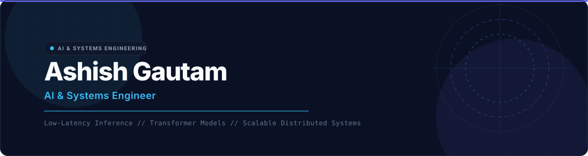

## Hi There!

<picture>
  <source media="(prefers-color-scheme: dark)" srcset="https://readme-typing-svg.demolab.com?font=Fira+Code&weight=500&size=16&duration=2600&pause=1200&color=58A6FF&width=560&height=36&lines=AI+%26+Systems+Engineer;Optimizing+Low-Latency+ML+Inference;Transformer+World+Models+%26+Explainability;Distributed+Backends+%7C+FastAPI%2C+Redis%2C+Celery">
  
</picture>

I'm Ashish, an AI and Systems Engineer with a focus on machine learning infrastructure and distributed backends.
- Specializing in low-latency inference, model quantization, and containerized architectures
- Building high-throughput backend services, asynchronous queues, and automated data pipelines
- Winner of [ISRO's Quantum Frontiers Award](https://lnkd.in/p/dbRMBmAm) at the Smart India Hackathon 2025

## Projects

| Repository | Link | Description | Awards / Highlights |
| :--- | :--- | :--- | :--- |
| [PacketSentinel](https://github.com/AshishGautamX) | [Website](https://packetsentinel.streamlit.app/) | Transformer world model for temporal network intrusion detection | 92.41% Macro-F1, 17.7x false-alarm cut |
| [Mulyankan AI](https://github.com/AshishGautamX) | [Website](https://mulyankanai.netlify.app/) | Distributed AI grading platform backend with OCR parsing & Celery job queues | National Finalist (Top 20), NHIDE Hackathon |
| Quantum-Secure Architecture | [ISRO Recognition](https://lnkd.in/p/dbRMBmAm) | Quantum-secure communication and defense systems | National Winner (ISRO Award), SIH 2025 |

## Experience

| Position | Company | Field | Work Period |
| :--- | :--- | :--- | :--- |
| **AI Developer** | **Thesisly** | **Backend AI Systems & Model Optimization** | **2025-09 — Present** |
| Web Development Intern | Adcuesta | Operations Dashboards & REST APIs | 2025-12 — Present |

## Education

- B.Tech in Computer Science and Engineering @ Guru Ghasidas Vishwavidyalaya (2023 - 2027)

## Technologies I Use

## Socials

